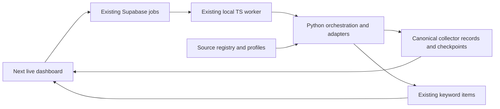

# Public data collectors: TrendRail integration plan

Reviewed: 2026-11-11. Status: proposed implementation plan; no collectors enabled or production data changed.

Input: [Public Data Collector Integration Guide v1.0.0](../reference/public_data_collector_agent_integration_guide.md).

Recommendation: extend the existing Python collection service and Supabase job path. Prove the integration with Hacker News, then add GDELT and Bluesky when access checks pass. Add Thailand Trends through a separate signal display. Keep YouTube channel subscriptions distinct from keyword search.

**Data-quality rule:** every record passes an ingestion gate before any database write — structural validation, canonical identity/dedupe, scope/relevance, language, spam heuristics and retention checks. Rejected records are counted by reason and never stored; borderline records can be logged to a local dry-run report for tuning. Filters must be versioned and must not delete existing user data.

## 1. What the repository actually runs

| Area | Observed implementation | Integration consequence |
|---|---|---|
| Web | Next.js App Router in `apps/web`; `/` uses fixtures, `/live` uses server-side Supabase queries | Extend live routes and preserve the mock boundary |
| Trigger | `enqueueFetch()` creates a Supabase `jobs` row | Reuse this queue rather than adding another job service |
| Worker | `apps/worker/src/index.ts` polls jobs, then POSTs to Python | It is an HTTP bridge; it does not currently implement its own collectors |
| Collection | `backend/server.py` implements YouTube search, Google News RSS, TikTok, FB Ads and TikTok Ads | Put new HTTP/RSS adapters in `backend/collectors/`; retain existing collectors during rollout |
| Storage | `backend/db.py` uses PostgREST when configured; otherwise atomic JSON files | Preserve both modes and test both mappings |
| Deployment | `docs/DEPLOY.md` identifies Vercel as primary and the worker as local | Collection remains dependent on the local worker and Python process being online |
| Tests | 18 Python unittest cases, forced local storage; worker TypeScript check and workspace build | Add focused parser, quality-gate, persistence and queue coverage to the existing checks |

Local configuration has all required Supabase settings and strict mode enabled. Only the presence of configuration was checked; credentials were not printed and database contents were not queried.

Documentation check before implementation: read the root `AGENTS.md` and the current code; the code is the source of truth. This plan records observed code and does not change the migration status.

## 2. Read-only endpoint evidence

Requests started at **2026-11-11 07:49:07–08 UTC** from this workstation. These were anonymous connectivity/parser checks using Python stdlib, a development User-Agent and a 2 MB response cap. **Zero records were ingested.** Results are specific to these requests and this network.

| Candidate | Exact request | Observed result | Rollout decision |
|---|---|---|---|
| Hacker News | `https://hn.algolia.com/api/v1/search_by_date?query=Thailand&tags=story&hitsPerPage=5` | HTTP 200, `application/json`; `hits` array with 5 records | First content adapter to exercise end to end, subject to storage/use approval |
| Thailand Trends | `https://trends.google.com/trending/rss?geo=TH` | HTTP 200, `text/xml`; RSS with 10 items | First signal adapter, after signal storage/display exist |
| GDELT | `https://api.gdeltproject.org/api/v2/doc/doc?query=Thailand&mode=artlist&format=json&timespan=1d&maxrecords=5` | Read timeout; no HTTP status captured; elapsed about 25 seconds | Retry from the intended collector host; keep disabled until verified |
| Bluesky Search | `https://public.api.bsky.app/xrpc/app.bsky.feed.searchPosts?q=Thailand&limit=5` | HTTP 403, `text/html` | Mark blocked for this test; establish supported access before enabling |
| YouTube channel example | `https://www.youtube.com/feeds/videos.xml?channel_id=UC_x5XG1OV2P6uZZ5FSM9Ttw` | HTTP 404, `text/html` | Recheck with a verified configured channel; this result does not establish general feed availability |

HN fields observed include `objectID`, `title`, `url`, `author`, `points`, `num_comments`, `created_at`, `created_at_i` and `updated_at`. Trends items included `title`, `pubDate`, `link` and the namespace `https://trends.google.com/trending/rss` with `approx_traffic`, picture and news-item fields. Preserve the traffic label as supplied.

No tested response supplied `Retry-After`; rate-limit behavior remains untested. HN and Trends supplied neither ETag nor Last-Modified in these responses. No conclusion about storage licenses, commercial rights, Thai brand coverage or comprehensive recall follows from a successful HTTP request. `Thailand` was a test query, not a proposed business keyword.

## 3. Integration design



Keep new adapters in a small `backend/collectors/` Python package: contract, registry, HTTP helper, quality gate and one module per implemented source. Use stdlib `urllib`, `json`, `xml.etree.ElementTree`, `unicodedata`, `dataclasses` and existing PostgREST helpers. Do not copy the guide's TypeScript directory tree into a second collection service.

The registry separates **connector ID** from **provider/source ID**. For example, `youtube_channels` and the existing YouTube search are different acquisition methods for the same video platform. Each entry declares supported scope (`keyword`, `country`, `channel`, `page`, `dataset`, or manual), enabled state, access requirements, record kinds, terms status and configuration requirements. Export only safe registry fields to the live UI.

Use existing `fetch` jobs for keyword/profile searches. Add an explicit `collect` job and `/api/collect` handler for resource scopes, such as `connector_id=google_trends_th` with `{geo: "TH"}` or a configured channel ID. Do not invent a keyword to satisfy `/api/fetch` for a country feed. Keep existing `fetch` and `refresh_views` payloads compatible; reject unknown job kinds instead of treating all of them as fetches.

### Registry and source IDs

The registry is the only allowlist for collection. A connector declares its provider, scope, record kinds, access/rights state, quality policy and config requirements. Proposed IDs:

| connector_id | source | scope | record_kind | First release |
|---|---|---|---|---|
| `hn_search` | `hackernews` | keyword | content | **yes** |
| `google_trends_th` | `google_trends` | country | signal | after content path |
| `gdelt_doc` | `gdelt` | keyword | content | after connectivity check |
| `bluesky_search` | `bluesky` | keyword | content | after access check |
| `youtube_search` | `youtube` | keyword | content | existing |
| `youtube_channels` | `youtube` | channel | content | later |
| `gnews_search` | `gnews` | keyword | content | existing |
| `tiktok_search` | `tiktok` | keyword | content | existing |
| `fbads_library` | `fbads` | keyword | content | existing |
| `ttads_creative` | `ttads` | keyword | content | existing |

`sources` in `items`/`source_status` must use the `source` value (for example `hackernews`), not the connector ID. Keep both columns in new tables: `collector_records.connector_id` records how the record was acquired, while `source` identifies the platform.

### Ingestion quality gate (before any write)

No adapter writes directly to `items` or `collector_records`. Every batch passes this pipeline:

| Step | Rule | On failure |
|---|---|---|
| 1. Transport | HTTP 2xx, allowed content type, size/time caps, no redirect to a blocked host | `transport_error` |
| 2. Parse | Required fields present; namespaces/optional fields tolerant | `malformed` |
| 3. Normalize | NFC text, trim, strip HTML/control chars, canonical URL (https, remove tracking params), UTC timestamps | `bad_url` / `out_of_window` |
| 4. Identity | Stable `source_item_id`; canonical URL; content hash | `missing_identity` |
| 5. Dedupe | Exact source ID → update counters; existing canonical URL → link provenance; cross-source near-duplicate → link, do **not** discard the distinct post | `duplicate_exact` (count only) |
| 6. Scope | Keyword/geo/channel/dataset match; configured language (Thai/English) | `out_of_scope` / `unsupported_language` |
| 7. Quality | Spam/blocklist heuristics, title sanity, finite non-negative metrics, rights/retention policy | `spam` / `metric_invalid` / `rights_blocked` |
| 8. Write | Upsert accepted records, links and `items` projection; checkpoint last | `storage_error` (do not advance cursor) |

Rules:

- **Hard rejects only** for structural/identity/safety/scope failures. Do not hard-reject on low HN points or low engagement in the first release; rank or score instead, otherwise new stories disappear.
- **Provider-side keyword scopes count as scope.** HN/GDELT search results are already query-scoped; do not require the keyword to appear in the title/body or valid results will be dropped. Text match is a ranking signal, not a hard reject.
- **No trash stored:** rejected records are not written to Postgres. Store per-run counts by reason in `collector_state`/run stats. For tuning, `dry_run` may write a local `data/reports/collector-<connector>-<date>.jsonl` with URL hashes and reason codes only — no title/body — and that path stays gitignored.
- **Quarantine = dry-run only:** records that trip soft quality flags are counted as `quarantined` and appear only in the local report; they are never inserted into Postgres until a reviewer changes the rule.
- **No full article text:** store title/URL/metadata plus, only if rights approval exists, a capped excerpt (default 500 chars). HN stories link to the external article; do not scrape the article body.
- **Over-filtering guard:** run the gate in log-only mode against 50–100 real records per new adapter; owner reviews a sample before hard rejects are enabled. Record the review date in the registry/rights field.
- **Versioned rules:** accepted records store `quality_rules_version`; changing rules affects new runs only. Never delete or rewrite existing user items as a filter migration.
- **Thai/English only by default**; per-connector language config is allowed. Short titles are flagged, not rejected. Metrics must be finite and non-negative; unknown stays `null`, never `0`.
- **Counters per run:** `fetched, parsed, accepted, rejected{reason}, duplicates, linked, inserted, updated, quarantined`. Sources UI must show rejected/blocked counts, not just “no data”.

### Collect job contract (proposal)

```json
{
  "kind": "collect",
  "payload": {
    "connector_id": "hn_search",
    "scope": { "keyword": "Thailand" },
    "mode": "manual",
    "dry_run": true,
    "max_records": 50,
    "quality_rules_version": "2026-11-11.1"
  }
}
```

- Allowlist `connector_id`; reject unknown fields, invalid scopes and unknown kinds.
- `mode=manual|scheduled`; `dry_run` never writes to Postgres.
- Worker dispatch: `collect` → `POST /api/collect`; `fetch`/`refresh_views` keep their current endpoints.
- Return counts by quality reason; a job with only rejects is **done with 0 accepted**, not an error.

### Draft schema (owner approval required)

Minimum fields; final SQL needs owner review before migration:

- `collector_records`: `id`, `user_id`, `source`, `connector_id`, `source_item_id`, `record_kind`, `content_type`, `url`, `canonical_url`, `title`, `text_excerpt`, `author_id`, `author_display`, `language`, `market`, `published_at`, `observed_at`, `engagement jsonb`, `numeric_signal`, `signal_unit`, `keywords_matched text[]`, `raw_source_ref jsonb` (sanitized provider fields only, never raw HTML/full body), `quality_score`, `quality_flags text[]`, `quality_rules_version`, `is_deleted`, `deleted_at`, `created_at`, `updated_at`. Unique `(user_id, source, source_item_id)`.
- `collector_item_links`: `user_id`, `record_id`, `item_id`, `keyword`, `connector_id`, `first_seen_at`; unique `(record_id, item_id)`.
- `collector_state`: `user_id`, `connector_id`, `scope_key`, `cursor jsonb`, `cache_validators jsonb`, `last_run_at`, `last_status`, `last_error`, `counters jsonb`, `next_due_at`; unique `(user_id, connector_id, scope_key)`.
- `jobs` additions: `lease_owner`, `lease_until`, `attempts`, `schedule_key` (unique when not null).
- Indexes: records `(user_id, source, observed_at desc)`, `(canonical_url)`, links `(item_id)`, state `(next_due_at)`.
- RLS: owner-scoped like existing tables; service role only on server/worker.

Keep the package at `backend/collectors/` so it ships with the existing `COPY backend` Docker step.

### Metrics and aggregate rules

| Source | `items.metric` | Ranking value | Aggregate |
|---|---|---|---|
| YouTube | `views` | views | compatible engagement total |
| TikTok | `plays` | plays | compatible engagement total |
| Hacker News | `points` | points | separate; never added to views/plays |
| Google News | none (`null`) | recency/keyword only | not scored |
| FB Ads / TikTok Ads | none (`null`) | recency only | not scored |
| Google Trends / Wikimedia | signal record only | supplied bucket/unit | not an `items` row |

- `items.score` is the numeric value for display/ranking; keep `metric` explicit and unknown values `null`.
- Hot/Rising thresholds are per metric/source, not one global score. Do not compare HN points with video views.
- `getSummary()` currently caps at 3,000 rows. Totals and per-source counts must come from aggregate/count queries; top-items and top-terms must be labeled sampled unless they are exhaustive.

### Canonical records and existing keyword items

The guide's unique source record and TrendRail's per-keyword item are different entities. Preserve both identities:

| Proposed storage | Purpose |
|---|---|
| `collector_records` | Canonical normalized payload; unique `(user_id, source, source_item_id)`; typed identity/kind/timestamps plus source-specific metadata and engagement |
| `collector_item_links` | Links canonical content records to existing `items` rows, preserving multiple keywords and multiple discovery sources |
| `collector_state` | Durable cursor, cache validators, next eligible fetch and health per owner/connector/configured scope |
| Existing `items` | Content projection for current lists, CRUD, archive, trash and keyword totals; keep `(user_id, keyword, canonical_url)` uniqueness |

Content enters `items`; search trends, pageview signals and datasets remain in `collector_records` with explicit kind/unit displays. Match a canonical content record to each relevant keyword item through the link table. A URL collision links additional provenance to the existing item; it must not overwrite that item's original attribution. Distinguish unique displayed articles from acquisition records in counts.

Keep `published_at` source-provided and nullable when unavailable. Keep `observed_at` as collection time, UTC. Preserve author IDs separately from mutable handles, unknown metrics as null, and permitted provenance. HN points are points, not likes; Trends traffic is a bucket label, not an exact integer. Use NFC for stored normalized text and document any additional normalization used only for matching.

New source writes must use targeted upserts, **not** `db._save_items()` with a partial batch: that helper deletes existing rows missing from its input snapshot. Persist records, keyword links/projections and then checkpoints. For Supabase, use a transaction/RPC for the batch commit; for JSON mode, serialize writes, save data first and checkpoint last, and make replay idempotent. Do not advance a checkpoint on a storage failure or silently switch stores in strict mode.

Introduce the three tables additively with owner scoping and RLS. Extend the existing `items.source` and `source_status.source` checks for approved providers. Keep the service role on server/worker. Prepare SQL for review before applying it; do not rewrite old migrations or bulk-migrate existing items in the first release.

Source deletion is separate from user trash/archive. A confirmed provider deletion hides linked content and removes content fields according to the approved retention policy; user restore must not revive removed provider content. A missing search result alone is not proof of deletion. Poll-only sources must disclose deletion-detection limits.

## 4. Problems to address along the integration path

| Current behavior | Required integration change |
|---|---|
| `merge_items()` skips existing URLs and applies title similarity to selected organic sources | New ingestion upserts by stable source ID and updates counters; do not discard distinct posts with similar text |
| `db._item_row()` maps unknown sources to `manual`; `db.save()` filters source-status names | Extend mappings together with schema constraints so source identity is retained |
| `getSourceStatus()` selects `message,updated_at`, while the migration defines `error,checked_at` | Correct the read mapping; verify the deployed schema; surface read failures instead of silently returning no history |
| Sources page lists sources only when summary items exist | Render configured sources from the registry, including empty, disabled, blocked and signal-only sources |
| Source unions, labels, filter lists, picker options and archive counts are hard-coded | Update each consumer from the same registry contract |
| `getSummary()` adds every item score into a total and average | Aggregate compatible metrics separately; keep signals out of generic engagement totals and Hot/Rising thresholds |
| Summary reads cap at 3,000 rows | Use actual aggregate counts for totals; identify any sampled top-items/terms view rather than calling it exhaustive |
| Worker heartbeat runs before a potentially long job; progress is set to 1/1 at completion | Keep heartbeat alive during work and report actual source/page progress |
| Worker checks cancellation only before starting; running jobs have no recovery lease | Propagate cancel between sources/pages; add ownership/lease recovery and bounded attempts before recurring jobs |
| Queue reads/writes lack explicit owner filtering and several fetch responses are unchecked | Scope claim/update/read operations to the configured owner, validate HTTP responses and avoid silently losing job-state updates |
| Import/export paths preserve only the old item fields | Keep version-1 imports working; add a versioned collector backup that round-trips records, provenance, links and state without dropping archive/trash |
| Adapters currently have no shared pre-write gate; malformed, spam, off-topic or duplicated rows could reach storage | Put every batch through the quality gate in §3; persist only accepted records and per-run reject counts |
| Run health reports only job status/progress, not why records were rejected | Surface `fetched/parsed/accepted/rejected{reason}/duplicates` per connector and last run |

Treat the source-status field discrepancy as a code-versus-migration finding until the deployed schema is inspected. Other rows describe observed code paths, not claims of a production incident.

## 5. Delivery sequence and gates

### Phase 0 — agree scope and freeze the current baseline

- Migration closed 2026-11-11; treat production `/live` and this repo as the baseline. Do not reopen completed gates.
- Review and approve the source list, source IDs, draft DDL, collect-job contract, retention/redistribution policy and quality thresholds (hard rejects vs log-only).
- Run the quality gate in dry-run mode on 50–100 real HN records; owner reviews a sample for relevance, language and spam before rejects are enabled.
- Capture a complete export and record active/archive/trash counts before a migration; use isolated fixtures for tests because local Supabase is configured.
- Audit a sample of existing `items` for spam, duplicates, broken URLs and off-topic rows. Report only; do not delete user data without explicit owner approval.
- Recheck blocked candidates from the intended collector host. Save scrubbed fixtures and endpoint/status/content-type evidence for every source that will be enabled.

Gate: approved scope, DDL/job contract, retention and quality policy; baseline backup; dry-run sample reviewed; explicit readiness state per candidate.

### Phase 1 — normalization and safe persistence

Split into two bounded releases.

#### Phase 1a — contract, registry, schema, quality gate (no live writes)

- Add `backend/collectors/`: contract, registry, bounded HTTP helper, normalization, identity/dedupe and the quality gate.
- Add the additive migrations and JSON equivalents; `collect` job validation; new sources default disabled.
- Implement hard rejects, quality flags/scores, rules version, per-run counters and local dry-run reports (no rejected content in Postgres).
- Correct the source-health read mapping (`checked_at`/`error` vs `message`/`updated_at`) and run it against the deployed schema.

Gate: owner-approved DDL; fixture tests pass for malformed/empty/HTML/wrong-language/spam/future-date/metric-anomaly/duplicate inputs; a dry run performs zero database writes; existing tests/export still pass.

#### Phase 1b — persistence and job dispatch

- Target upserts for records, links and `items`; stable IDs; counter updates; tombstones; checkpoint commit after durable writes.
- Explicit `collect` dispatch in Python and the worker; reject unknown kinds; owner-scoped claim/update.
- Compatible backup/import and source-health UI states: success, zero results, blocked, rate limited, parse error, rights review.

Gate: fixture tests prove two-keyword coverage, mutable metrics, archive/trash preservation, partial-batch safety, crash/replay without cursor loss, and zero accepted malformed rows.

### Phase 2 — first content adapters and live integration

1. **HN stories first:** use `objectID`, HN discussion permalink, external article URL as metadata, source points/comments and time-filter overlap. Comments can follow after stories are proven. Ship in `dry_run` first, review the sample, then enable writes.
2. **GDELT article metadata:** enable after connectivity passes. Validate query translation, seen-date semantics, result limits and overlapping windows; report truncation/gaps rather than assuming a complete news corpus.
3. **Bluesky Search:** enable only after supported access works. Use AT URI/DID identity, available pagination/time bounds and mutable counters; retain the current 403 as evidence until superseded.

Wire approved sources into live source selection, profiles, items, archive filters, counts and source-health displays. Exercise single-keyword and existing profile jobs. Do not create default business keyword sets.

Gate per enabled adapter: endpoint smoke passes, fixture and quality-gate tests pass, dry-run sample approved, web job persists only accepted records, a repeat run deduplicates and updates, and UI attribution/reject counts are correct. A disabled or blocked adapter does not count as delivered working coverage.

### Phase 3 — Thailand Trends and channel feeds

- Poll Thailand Trends as a country signal. Store supplied traffic labels, observation times, publication times and related article metadata. Use a stable occurrence key based on country/topic/start time where no provider ID exists; validate it against fixtures.
- Run Trends records through the same quality gate (scope=TH, valid URL/time, no empty titles) and keep signal counts separate from content rejects.
- Display signals with their units and scope through the existing live visual system; do not insert them into content engagement totals or arbitrary keyword searches.
- Add YouTube Atom polling only for a verified, owner-configured channel list. Deduplicate video IDs across channel polling and keyword acquisition where both are used; update title/description metadata without fabricating unavailable counts.
- Defer WebSub until polling works and a public callback is authorized; its documented topic URL differs from the tested polling path.

Gate: repeat feed fetches update the same occurrence/video correctly, missing optional namespaces do not crash parsing, signal labels remain separate from content metrics, and a dry-run sample is approved.

### Phase 4 — reliable recurring collection

- Reuse the existing jobs table/worker with one collector job at a time initially. Decide the scheduler host explicitly — worker loop timer vs external cron — before enabling recurring jobs. It enqueues due resource scopes; it does not create a separate execution pipeline.
- Add unique scheduling keys, active-job dedupe, attempts, retry timing and job leases. Restart recovery must replay safe work without overlapping the former owner.
- Keep source/query/channel/instance checkpoints independent. Honor Retry-After, cap retries/payloads/timeouts and validate content type and schema before parsing.
- Commit each successful source/page durably so a later source failure or cancellation does not discard it. Keep failures visible and let independent sources continue.
- Persist pagination/overlap state only after durable writes; flag a capped or incomplete window. Do not infer unsupported backfill or guaranteed no-loss coverage.
- Store `quality_rules_version` and per-run reject counters with each scheduled run. Rule changes apply to new runs only; no retroactive deletion of accepted content.
- Start manual-only, then enable selected recurring sources after the existing manual-write policy is explicitly updated. Document that the owner's PC being offline pauses collection.

Gate: simulated 429/5xx/HTML/malformed data, mid-job cancellation, process restart and worker-offline flows behave correctly; source health shows stale, partial, failed runs and reject counts accurately; quality rule changes do not rewrite old records. Deployment smoke and mobile/desktop checks pass.

## 6. Remaining guide sources

| Source | Planned treatment after the first releases | Readiness evidence still needed |
|---|---|---|
| Wikimedia | Interest signals by configured page/date | Existing pages, current access/rate policy, real operator contact, pageview-unit tests |
| Mastodon | Per-instance public posts/hashtags | Explicit instance allowlist, access test, canonical URI dedupe and HTML sanitization |
| RSSHub | Optional permitted feeds | Approved self-hosting, documented routes and route-specific auth/rights tests |
| Common Crawl | On-demand historical enrichment | Catalog/index test, resource limits and WARC parser dependency approval |
| data.go.th | Named dataset imports | Resource URL, license, encoding, dates/geographic units and any required token |
| Jetstream | Deferred live-stream capability | Demonstrated need/capacity, chosen protocol version, reconnect/backfill/deletion tests |
| Meta Ad Library | New manual advertising observations | Reviewer, source ID/URL, timestamp and permitted visible fields; separate approved API path if available |
| TikTok Creative Center | New manual research observations | Region/time filters, observation time and visible units; no assumed anonymous API |
| Google News | Existing collector retained pending an explicit policy decision | Intended storage/redistribution review before enabling it under the new registry policy |

These remaining adapters were not transport-tested in this review. Verify their current provider documentation and source-specific acceptance tests before implementation. All of them use the same ingestion quality gate and dry-run sample review before any writes are enabled.

The guide's manual-first Meta/TikTok approach differs from the existing Playwright collectors. Adopting the guide does not automatically authorize disabling the existing sources or treating their access as approved. Resolve that policy difference explicitly; new adapters follow the guide's access requirements.

## 7. Expected files and verification

| Files | Intended work |
|---|---|
| `backend/collectors/*.py` (new) | Contract, registry, HTTP helper, quality gate and only the adapters implemented in the current phase |
| `backend/server.py`, `backend/db.py` | Orchestration, dispatch, targeted persistence, local compatibility and checkpoints |
| `supabase/migrations/<new>_collectors.sql` | Additive records/links/state schema, source constraints, jobs lease/attempt fields and transactional commit operation |
| `apps/worker/src/index.ts`, `apps/web/lib/data/jobs.ts` | Explicit kinds/scopes, reliable execution, ownership, heartbeat, progress and cancellation |
| `apps/web/lib/types.ts`, `apps/web/lib/data/{live,items,items-query,counts}.ts` | Canonical read models, provenance, source health, reject counts and accurate aggregates |
| Live actions/pages/components, including `fetch-strip.tsx`, `source-icon.tsx`, `item-rows.tsx`, `job-status.tsx` | Registry-based controls and labels; preserve the established UI |
| Python/Next import/export routes and actions; legacy `legacy/live/index.html` | Round-trip compatibility and safe behavior for legacy consumers |
| `tests/test_collectors.py`, `tests/fixtures/` (new) | Source fixtures, quality-gate cases, HTTP failures, replay, persistence and normalization coverage |
| `Dockerfile` | No change needed; `COPY backend` already includes `backend/collectors/` |
| `docs/DB.md`, `docs/DEPLOY.md`, operating docs | Final schema, run commands, supported sources, reject policy and rollout/rollback instructions |
| `docs/reports/collector-integration.md` (deliverable) | Per-source endpoint, timestamp, observed fields/status, accepted/rejected counts, rights decision, rate-limit evidence, gaps and next action |

Before each enabled-source release, run the existing Python suite and compile checks, worker typecheck and workspace build. Add focused fixture tests for stable IDs, missing fields, Thai Unicode, true empty results, provider HTML/errors, metric updates, checkpoint recovery and deletion behavior. Add quality-gate tests for malformed/missing-identity rows, wrong language, off-topic scope, spam/blocklist, future timestamps, metric anomalies and exact/near duplicates; assert rejected records create zero Postgres rows and no full article text is stored. Include a log-only sample review before enabling hard rejects. Use a temporary local HTTP server for deterministic retry and content-type tests; do not hammer real providers to test throttling.

Use an isolated database/test owner to validate migrations, constraints/RLS, strict failures and transactional recovery. Verify `/api/health` against the Python status counts, then Search Now/profile jobs, source selection, CRUD, archive/trash and full backup/import. Check `/` remains fixture-only and service keys stay server-side. Capture the required 390/1440 screenshots for changed live views and verify the legacy/static guard where supported.

**Quality acceptance before enabling writes:**
- Malformed, missing-identity and blocked-source records: **zero rows** written.
- Repeat run: **zero duplicate inserts**; counters update instead.
- Reject counters by reason match the fixture batch exactly.
- `dry_run` writes only the local report, never Postgres.
- No `text_excerpt` over the approved cap and no full article body.
- Owner approves the 50–100-record sample for relevance/language/spam; over-filtering is treated as a defect, not success.
- Existing `items`, archive/trash and export/import remain unchanged by filter tests.

Rollback: disable new registry entries and cancel their scheduled work; preserve canonical records and existing user data. Roll back application code with additive schema left in place until a separately reviewed cleanup. Do not drop tables or restore a backup over newer user edits as a routine rollback.

## 8. Implementation decisions that still require the owner

[The operating brief](../../AGENTS.md) says **"Must ask before"** **"changing Supabase schema/RLS, source list, or API contract"** and **"adding any dependency ... or changing the collector integration phases"**. Those are implementation gates, not a reason to stop this repository review or plan.

The concrete proposal for that review: Python adapters behind the existing local worker; the three additive tables plus jobs lease fields in the draft schema; explicit `collect` jobs; HN as the first adapter; GDELT/Bluesky conditional on access; Trends as the first signal. Owner must approve these before Phase 1:

1. **First-release set:** HN only, or HN + Trends? Do not enable GDELT/Bluesky until connectivity/access checks pass.
2. **DDL and IDs:** approve `backend/collectors/` registry, source IDs, table/index/RLS draft and `collect` payload.
3. **Retention/rights:** metadata + title + URL only, or capped excerpt? storage duration, redistribution and provider-deletion policy.
4. **Quality policy:** hard-reject reasons, per-source soft thresholds (if any), and who reviews the 50–100-record dry-run sample. Default first release: hard rejects only; engagement thresholds log-only.
5. **Scheduler:** local worker timer vs external cron; concurrency 1; owner-PC offline behavior.
6. **Existing collectors:** keep Playwright + Google News as-is, or migrate them to the guide's manual-first policy.
7. **Metrics/Hot-Rising:** approve per-metric thresholds and the rule that HN points/Trends signals never enter view/play totals.

No new runtime dependency is proposed for the first releases.

## 9. Checks completed during this review

- `python -m unittest discover -s tests`: **18 passed**, temporary local storage.
- `python -m py_compile backend/server.py backend/db.py backend/pw_login.py`: passed.
- `npx tsc --noEmit -p apps/web/tsconfig.json`: passed.
- `npm run typecheck`: worker TypeScript passed.
- Vercel production build/deploy: succeeded 2026-11-11; legacy redirects verified 307 → `/live`.
- Five anonymous endpoint checks: results in section 2; no records stored.

Not performed: database reads/migrations, ingestion writes, quality dry-run sample, license approval or complete provider-specific acceptance tests. Existing working-tree edits were preserved. This document is a plan, not the guide's completed integration report.

## 10. Provider references checked

- [Bluesky HTTP reference](https://endpoints.bsky.app/) and [official search implementation](https://github.com/bluesky-social/atproto/blob/main/packages/bsky/src/api/app/bsky/feed/searchPosts.ts): documentation does not supersede the failed access check above.
- [GDELT DOC API documentation](https://blog.gdeltproject.org/gdelt-doc-2-0-api-debuts/): article-list modes and query operators; the documented cross-language search uses translated coverage, so validate Thai terms and English aliases rather than assuming equivalent recall.
- [HN API](https://hn.algolia.com/api) and [provider repository](https://github.com/algolia/hn-search): compare current output with stored parser fixtures.
- [Google Trends help](https://support.google.com/trends/answer/3076011?hl=en): RSS export and bucketed search volume; preserve those semantics.
- [YouTube push notifications](https://developers.google.com/youtube/data/guides/push_notifications): channel upload/title/description events and the `xml/feeds` subscription topic; this does not establish working keyword search or polling availability for the tested channel.
